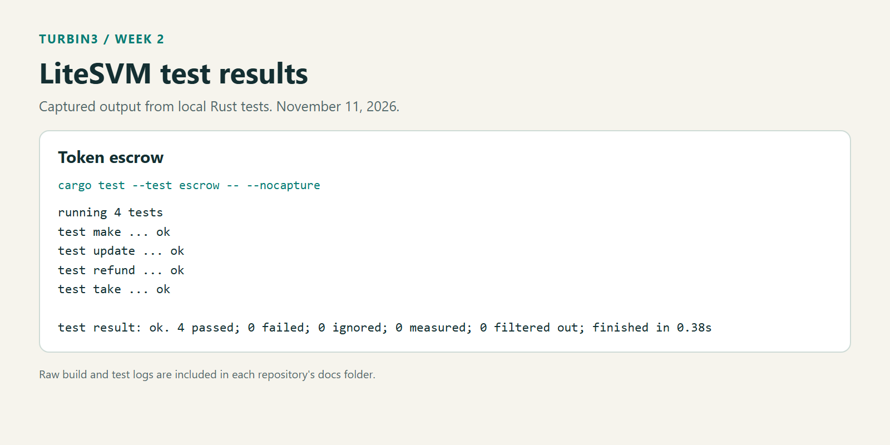

# Anchor Escrow Program

A simple Solana smart contract built with Anchor. It implements a basic escrow for token swaps where:

- The maker initializes an escrow PDA, deposits Token A into a vault, and specifies the amount of Token B to receive.
- The taker can "take" the deal by depositing Token B to the maker and withdrawing Token A from the vault (closing the escrow and vault as well).
- The maker can refund if no taker accepts, withdrawing Token A back and closing the escrow and vault.
- The maker can update the amount of Token B requested while the offer is open.

This is my Turbin3 Week 2 escrow assignment, built from the course starter. The Rust LiteSVM tests exercise regular SPL tokens locally.

## Instructions

| Instruction | Signer | What it does |
| --- | --- | --- |
| `make(seed, deposit, receive)` | Maker | Creates the offer and deposits Token A into its vault. |
| `take()` | Taker | Pays the saved Token B price to the maker, receives all Token A in the vault, and closes the offer. |
| `refund()` | Maker | Returns all Token A in the vault and closes the offer. |
| `update(receive)` | Maker | Changes the requested Token B amount. The new amount must be greater than zero. |

Amounts are in token base units. The tests use zero-decimal mints, so `100` means 100 tokens.

The escrow PDA uses `[b"escrow", maker_public_key, seed_as_u64_le_bytes]`. Its state stores the maker, both mints, requested amount, seed, and bump. The offered tokens live in the PDA's associated token account, rather than in the state account.

`take` moves both assets in one instruction. If either transfer fails, the transaction rolls back. The taker pays to create missing receiving token accounts. Closing the vault and escrow returns their rent to the maker.

The take test starts with 100 A offered for 200 B, updates the price to 150 B, and accepts the offer. It checks that the taker receives 100 A, the maker receives 150 B, and the taker keeps the remaining 50 B.

## Prerequisites

- Rust 1.89.0, as selected by `rust-toolchain.toml`.
- Anchor CLI and the Solana SBF build tools.
- The program uses `anchor-lang` and `anchor-spl` 0.32.1.
- Rust tests use LiteSVM 0.7.1. A running validator and JavaScript dependencies are not needed for these tests.

The local build was checked with Anchor CLI 1.1.2. It emits a CLI/library version warning; the program build and Rust tests still pass. Both the manifest and lockfile contain dependency versions needed by this starter, so keep `Cargo.lock`.

## Running Tests

From the repository root:

```sh
anchor build
cargo test --test escrow -- --nocapture
```

Build first. LiteSVM loads `target/deploy/anchor_escrow_q4_25.so`, so program changes need a fresh build.

| Test | Checks |
| --- | --- |
| `make` | Saved terms, vault deposit, and the maker's remaining balance. |
| `update` | New requested amount and unchanged vault balance. |
| `refund` | Returned deposit and closure of the vault and state. |
| `take` | Both sides' token balances at the updated price and account closure. |

The tests are in [programs/anchor-escrow-q4-25/tests/escrow.rs](programs/anchor-escrow-q4-25/tests/escrow.rs). The shared fixture prepares token accounts in memory, then executes the compiled escrow program.



[Full test output](docs/test-output.txt)

The original TypeScript tests remain in `tests/`. `anchor test` still selects those validator-based tests through `Anchor.toml`; use the explicit Cargo command above for the assignment's LiteSVM tests.

## Windows setup

LiteSVM's dependencies need OpenSSL development libraries on Windows. The local `.cargo/config.toml` points to the Win64 OpenSSL development installation at `C:\Program Files\OpenSSL-Win64` and links its static libraries. Update those paths for your machine. On other operating systems, remove those Windows-specific environment entries and use the appropriate OpenSSL development package.

For the installation used here:

```powershell
winget install --id ShiningLight.OpenSSL.Dev --exact --source winget
```

`Take` boxes its account containers to keep the generated account validation below the SBF stack limit.

## Scope

This version implements full fills, maker refunds, and price updates. It has no expiry or delivery condition. The tests cover the four successful instruction paths, not a complete set of invalid inputs or Token-2022 extensions. `make` retains the starter's behavior and does not explicitly reject zero deposit or receive amounts; `update` does reject a zero price.

The vault balance determines how much Token A is delivered or refunded, including any extra Token A sent directly to the vault. There are no partial fills or advanced market positions.
